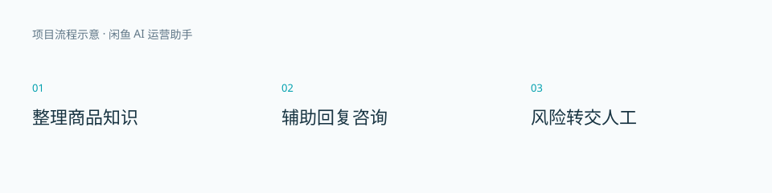

# 闲鱼 AI 运营助手

商品知识、客服辅助与人工接管。

这是作品展示仓库，包含项目介绍与演示说明。应用源码、激活逻辑和安装包未在此发布。

## 使用流程

1. 整理商品知识。
2. 辅助回复咨询。
3. 风险转交人工。

## 当前边界

结合商品资料与回复规则处理咨询；议价、售后和不确定问题转交人工。功能依赖平台登录状态及接口可用性，不承诺永久在线或无人值守运营。

## 演示

参见 [演示说明](DEMO.md)。目前没有公开在线演示或下载链接。流程图为原创说明图，不是运行截图或真实业务结果。

作者：[栈上观川](https://github.com/dpbingnet)
